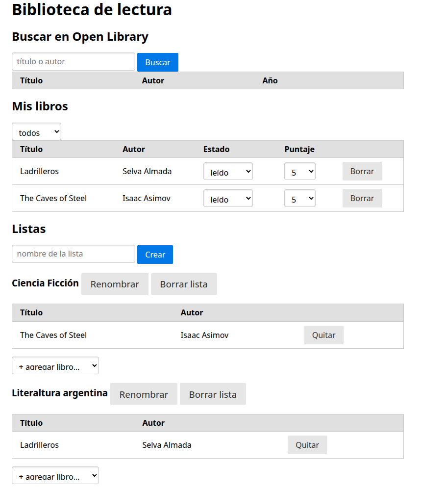

# TP Final

Alumno: Emanuel Guillén


Biblioteca de lectura: CRUD de libros (por leer / leyendo / leído) y listas de libros.
Busca libros en la API pública de Open Library y expone una API propia (FastAPI) sobre MariaDB.
MVC: `src/models` (datos), `src/routes` (controladores), `src/static/index.html` (vista).


## Diseño

API escrita con FastAPI, que conecta a una base de datos MySQL/MariaDB y sirve un archivo html con el CRUD.

## Ejecutar

### Con docker
Si tenés docker podés ejecutar 
```
    docker compose up --build
```

Esto levanta un contenedor con la DB y un contenedor que corre la API y la vista.

### Sin docker
Para ejecutar sin docker es necesario contar con una MariaDB corriendo.
1. Primer paso instalar las dependencias de Python
```
pip install -r requirements.txt
```
2. import la DB 
```
mysql -uroot -p < dbf/schema.sql
```

3. Correr (desde src/, porque main.py busca la carpeta "static" ahí)
```
cd src
DB_USER=miusuario DB_PASS=micontraseña ../.venv/bin/uvicorn main:app --reload
```

## Uso

- Hay una vista hecha en HTML y Javascript que consumen la API que queda funcionando en http://localhost:8000
- FastAPI, la librería utilizada para la API, genera la documentación de la misma en http://localhost:8000/docs

## DB de ejemplo
En `dbf/seed.sql` hay una base de datos de ejemplo que se puede utilizar para ver como se ve la información en la vista.
